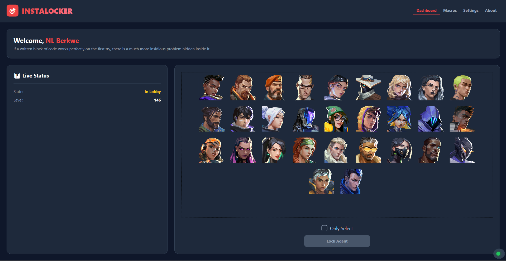

<p align="center">
  🌐 <a href="README.md">English</a> | Türkçe
</p>

<h1 align="center">🎮 Valorant Instalocker GUI v1.0.0</h1>

<p align="center">
  Valorant için hızlı güvenilir ve şık arayüzlü otomatik ajan kilitleme aracı — artık tam GUI ile.
</p>

---

## 📸 Önizleme



---

## ✨ Özellikler

### 🖥️ GUI Arayüzü
- Modern ve temiz grafik kullanıcı arayüzü — artık o boktan terminal penceresine mahkum değilsiniz.
- **Koyu & Açık tema** desteği — ayarlar panelinden tek tıkla tema değiştirebilirsiniz.

### 🔒 Ajan Kilitleme Modları
- **Kilitleme Modu:** Seçilen ajanı anında seçer ve kilitler. Klasik instalock davranışı.
- **Sadece Seçme Modu:** Ajanı seçer ama kilitlemez. Rekabetçi maçlarda instalock atmak istemeyenler için idealdir — süre dolduğunda Valorant otomatik olarak kilitler, AFK cezası almazsınız.

### 🌍 Çoklu Dil Desteği
- Birden fazla dil desteği mevcut, ayarlar menüsünden istediğiniz zaman değiştirilebilir.

### 🔄 Bozulma & Bağlantı Kesintisi Koruması
- Maç bozulursa veya ajan seçimi sırasında bağlantı kesilirse Instalocker tekrar kilitler.

### 🚫 Maç Bozma
- Ajanınız kilitlendikten sonra Instalocker üzerinde tek bir butonla maçı bozabilirsiniz — Not: Standart maç bozma cezaları geçerliliğini korur.

### 🔁 Otomatik Güncelleme
- **Velopack** ile güçlendirilmiş güncelleme sistemi — uygulama başlangıçta yeni sürümleri otomatik olarak kontrol eder ve kendini günceller. Manuel indirme gerekmez.

---

## 🔜 Yakında Eklenecekler

TUI (terminal) sürümünde bulunan aşağıdaki özellikler GUI sürümü için planlanmaktadır:

- **Harita Bazlı Ajan Seçimi (Makro Modu):** Profil dosyaları aracılığıyla her harita için farklı ajan ve mod belirleme.
- **Profil Sistemi:** Birden fazla harita profilini kaydedip aralarında hızlıca geçiş yapabilme.
- **Masaüstü Kısayol Oluşturucu:** Belirli ajan ve modlarla önceden yapılandırılmış masaüstü kısayolları oluşturma.
- **Oyun İçi Arayüz Desteği:** Oyunun içinden açılan popup'larla hızlıca instalock atabileceksiniz.
- **Sürüm Kontrolü & Güncelleme Bildirimleri:** Yeni bir sürüm çıktığında sizi uyaran, isteğe bağlı güncelleme bildirim sistemi.
- Ve TUI sürümündeki pek çok özellik daha...

---

## 📦 Kurulum

### 💿 Kurulum Dosyası (Önerilen)

Uygulamayı sisteminize kurar ve Velopack aracılığıyla otomatik güncelleme desteği sağlar.

1. Son sürümü indirin:
   [**Instalocker-GUI-Setup.exe**](https://github.com/Berkwe/Valorant-instalocker/releases/latest/download/Instalocker-win-Setup.exe)
2. Kurulum dosyasını çalıştırın ve adımları takip edin.
3. Kurulum tamamlandığında uygulama otomatik olarak başlar.

> Kurulum dosyası uygulamayı otomatik güncellemeler için kaydeder — yeni sürümler başlangıçta sessizce uygulanır.

---

### 📦 Taşınabilir Sürüm (Portable)

Kurulum gerektirmez. İndirin, çıkartın, çalıştırın.

1. Son sürümü indirin:
   [**Instalocker-GUI-Portable.zip**](https://github.com/Berkwe/Valorant-instalocker/releases/latest/download/Instalocker-win-Portable.zip)
2. Arşivi istediğiniz bir klasöre çıkartın.
3. `Instalocker-GUI.exe` dosyasını çalıştırın.

> ⚠️ Windows Defender, antivirüs veya SmartScreen yazılımınız dosyayı lisanssız olduğu için işaretleyebilir. Bu, paketlenmiş C# uygulamalarında sık karşılaşılan hatalı pozitif bir uyarıdır. Tercih ederseniz kaynak koddan kendiniz derleyebilirsiniz.

---

## 🏗️ Kaynak Koddan Derleme

### Gereksinimler

- [.NET 8.0 SDK](https://dotnet.microsoft.com/download) veya üzeri
- Windows 10/11
- Git (opsiyonel)

### Adımlar

1. **Projeyi klonlayın:**
   ```bash
   git clone https://github.com/Berkwe/Valorant-instalocker
   cd Valorant-instalocker-TUI
   ```

2. **Projeyi derleyin:**
   ```bash
   dotnet build --configuration Release
   ```

3. **Çalıştırın:**
   ```bash
   dotnet run --project Instalocker.GUI
   ```

   Ya da `bin/Release/net8.0/` klasörüne gidip `Instalocker.GUI.exe` dosyasını doğrudan çalıştırabilirsiniz.

### Tek EXE Olarak Yayınlama

```bash
dotnet publish -c Release -r win-x64 --self-contained true -p:PublishSingleFile=true -o ./publish
```

---

## 🛠️ Kullanım

### Ajan Seçimi ve Mod Belirleme

1. Uygulamayı başlatın.
2. Listeden ajanınızı seçin.
3. Bir mod seçin:
   - **Mod 1 – Kilitle:** Ajanı anında seçer ve kilitler.
   - **Mod 2 – Sadece Seç:** Ajanı seçer ama kilitlemez. Süre dolduğunda Valorant otomatik olarak kilitler.
4. **Kilitle** butonuna tıklayın ve Valorant'ta sıraya girin.

### Maç Bozma

Ajanınız kilitlendikten sonra **Oyunu Boz** butonu görünür hale gelir. Bu butona tıklayarak maçı bozabilirsiniz. Standart ceza kuralları geçerliliğini korur.

### Tema Değiştirme

**Ayarlar** menüsünü açın ve **Koyu** ile **Açık** tema arasında geçiş yapın. Değişiklik anında uygulanır.

### Dil Değiştirme

**Ayarlar → Dil** menüsünü açın ve listeden istediğiniz dili seçin. Arayüz hemen yeniden yüklenir.

---

## ⓘ Geri Bildirim & Hata Bildirimi

Hata bildirimleri, özellik istekleri veya performans sorunları için [**Issues**](https://github.com/Berkwe/Valorant-instalocker/issues) sayfasını kullanabilirsiniz.

---

## 🖤 Teşekkürler

- Valorant istemci iletişim katmanı için [**Radiant Connect**](https://radiantconnect.ca/) projesine teşekkürler.

---

## 🌟 Diğer Projelerim

- [Valorant Instalocker TUI](https://github.com/Berkwe/Valorant-instalocker-TUI)
- [ADB Brute-Force](https://github.com/Berkwe/ADB-bruteforce)
- [Audio Converter](https://github.com/Berkwe/Audio-converter)

---

## 📞 İletişim

<a href="https://discord.gg/Xagnh5aYSy" target="blank"></a>

---

## 📝 Lisans

Bu proje [MIT Lisansı](LICENSE) altında lisanslanmıştır.

---

## ⚠️ Sorumluluk Reddi

Bu yazılım tamamen **eğitim ve kişisel kullanım** amacıyla geliştirilmiştir. Yazılımın kullanımından doğabilecek her türlü risk — oyun içi yasaklamalar, hesap kısıtlamaları, veri kaybı dahil ancak bunlarla sınırlı olmaksızın — tamamen **kullanıcının sorumluluğundadır**. Geliştirici, bu yazılımın üçüncü taraf hizmet şartlarını (Riot Games vb.) ihlal etmesi veya kullanım sonucunda oluşabilecek hiçbir zarardan **sorumlu tutulamaz**. Bu aracı kullanarak bu şartları kabul etmiş sayılırsınız.

---

### 🔑 Anahtar Kelimeler
valorant instalocker, valorant gui instalocker, valorant auto lock, valorant agent locker, valorant instalock script, valorant ajan seçici, valorant instalocker gui, csharp valorant aracı, radiant connect
